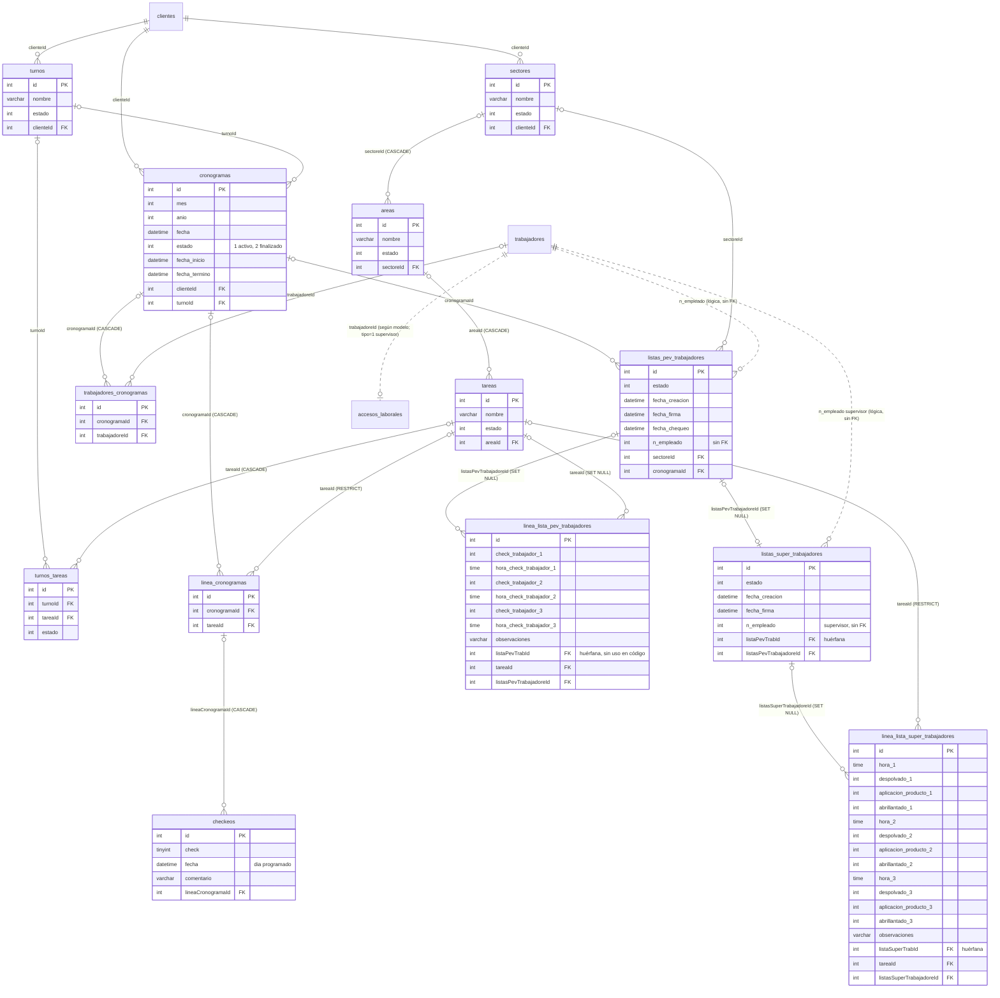
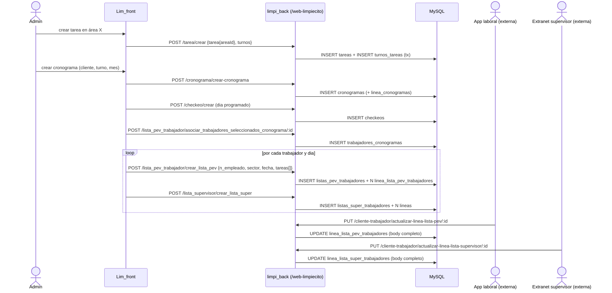
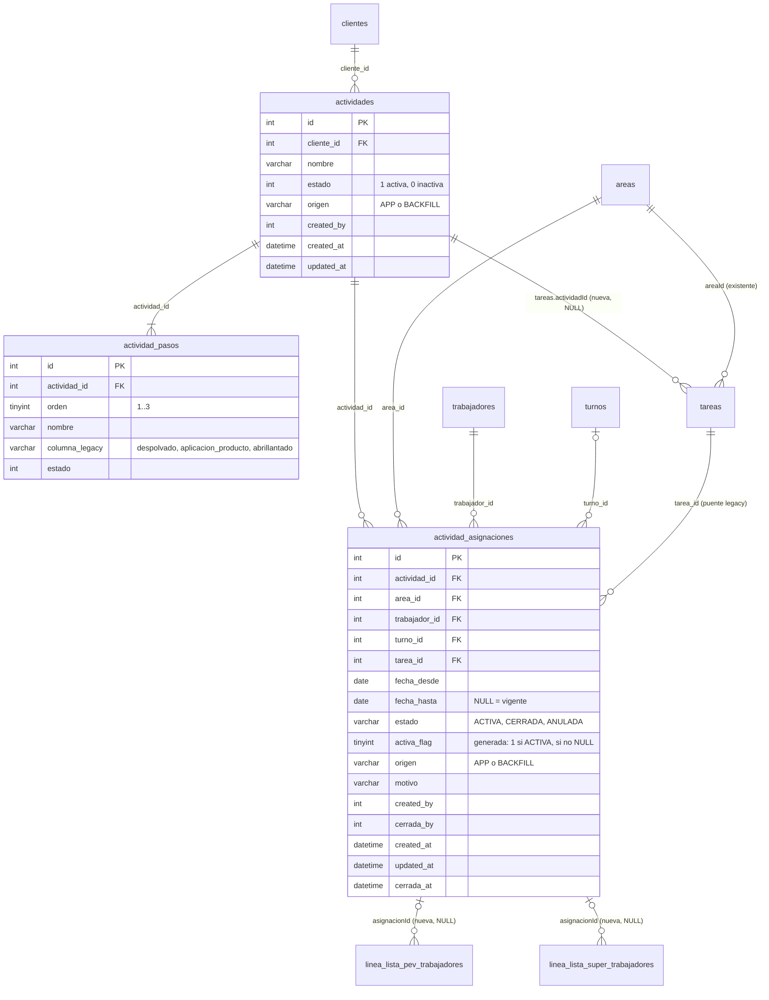

# Análisis del módulo PEV / Cronograma

## 0. Encabezado

### Resumen ejecutivo

- **Alcance:** solo análisis del módulo PEV / Cronograma. No se cambió código, esquema ni datos. El módulo está bloqueado hasta que el equipo lo autorice tras la reunión (spec §9).
- **Hallazgo principal:** no existe una entidad "asignación trabajador → área". La asignación es implícita en la lista PEV diaria. Además, cada actividad se repite por área, porque `tareas.areaId` es obligatorio.
- **Volumen repetido:** en la BD local, 96 filas de `tareas` tienen solo 21 nombres distintos. Los datos parecen sintéticos, así que ilustran el patrón pero no miden producción.
- **Pasos de limpieza fijos:** despolvado, aplicación de producto y abrillantado son columnas fijas, no una tabla. Aún no se confirma si `check_trabajador_1..3` son pasos o rondas.
- **Riesgos de seguridad:** las rutas PEV, de cronograma, checkeo, listas y `/cliente-trabajador/*` no tienen autenticación. Los updates permiten modificar campos como `tareaId` (mass assignment). Hay borrados físicos, incluido el del cronograma completo con su historial.
- **Recomendación RF-PEV-02:** agregar `actividades`, `actividad_pasos` y `actividad_asignaciones`, con `tareas.actividadId` y `asignacionId` NULL en las líneas. Las tareas actuales pasan a ser "tareas puente", para no romper el código legacy (c.1).
- **Migración:** solo aditiva (M1 esquema, M2 backfill idempotente), sin `sync({force|alter})` y sin borrado físico en las fases 1 a 4 (d.8).
- **Antes de avanzar:** responder las preguntas de e), en especial la 7 (`trabajadores.n_empleado` único, bloqueante) y la 1 (significado de `check_trabajador_1..3`).

### Ficha del documento

| Campo | Valor |
|---|---|
| Estado | **Borrador para la reunión técnica** con el desarrollador original. No aprobado. |
| Fecha | 2026-11-14 |
| Alcance | Solo análisis (spec §9, "Tarea permitida ahora"): ER actual, flujo real de creación y asignación, propuesta RF-PEV-02 (base de RF-PEV-01) y plan de migración de datos. No se cambió código, esquema ni datos. |
| Fuentes | Código `limpi_back/` y `Lim_front/` (rama `docs/analisis-pev-aaron`); DDL real y `COUNT(*)` de la BD local `aseolimp_minda_oficial09`; `Docs/requerimientos-limpiecito.md` §9 (líneas 559-590). |
| Fuera del repo | App laboral (trabajador) y extranet de supervisor: solo existe su backend (`/cliente-trabajador/*`, `/acces_laboral/*`). Su comportamiento se infiere de lo que el backend expone. |

> **Módulo BLOQUEADO (spec §9).** No se modifica el esquema ni la lógica PEV hasta que el equipo lo autorice explícitamente tras la reunión técnica. Todo lo de las secciones c), d) y f) es propuesta.

> **Datos locales.** Los conteos de la BD local son múltiplos exactos de 8/24/96 (16 sectores, 32 áreas, 96 tareas, 576 líneas, 288 trabajadores-cronograma). Con alta probabilidad son datos sintéticos de prueba, no una copia de producción. Sirven para entender la forma de los datos, **no para estimar volúmenes de producción**.

Las referencias `archivo:línea` se verificaron leyendo el código. Lo que no se pudo verificar se indica en el texto y se recoge en e) y en "Pendientes de verificación".

---

## a) Diagrama entidad-relación actual

Relaciones con línea continua = FK real en el DDL. Línea punteada = relación **lógica sin FK**. Todas las FK son columnas `NULL`-ables (`DEFAULT NULL`), de ahí la cardinalidad `o` en ambos extremos. Ningún modelo usa timestamps (`timestamps:false`).



| Tabla | COUNT local | Modelo Sequelize |
|---|---|---|
| sectores / areas / tareas | 16 / 32 / 96 | `limpi_back/modelos/apartado_listas_pev/{sector,area,tarea}.js` |
| turnos / turnos_tareas | 8 / 96 | `.../apartado_listas_pev/{turno,turnoTarea}.js` |
| cronogramas / linea_cronogramas / checkeos | 96 / 576 / 3312 | `limpi_back/modelos/apartado_cronograma/{Cronograma,Linea_cronograma,checkeos}.js` |
| trabajadores_cronogramas | 288 | `.../apartado_listas_pev/trabajadorCronograma.js` |
| listas_pev_trabajadores / linea_lista_pev_trabajadores | 96 / 576 | `.../apartado_listas_pev/{listaPevTrabajador,lineaListaPevTrabajador}.js` |
| listas_super_trabajadores / linea_lista_super_trabajadores | 96 / 576 | `.../apartado_listas_pev/{listaSuperTrabajador,lineaSuperTrabajador}.js` |

**Notas**
- **FK lógicas sin restricción:** `listas_pev_trabajadores.n_empleado` (trabajador) y `listas_super_trabajadores.n_empleado` (supervisor) apuntan a `trabajadores.n_empleado`, que **no tiene índice UNIQUE** en el DDL. Si dos trabajadores comparten `n_empleado`, la relación es ambigua.
- **FK duplicadas:** `linea_lista_pev_trabajadores` y `listas_super_trabajadores` tienen `listaPevTrabId` **y** `listasPevTrabajadoreId`; `linea_lista_super_trabajadores` tiene `listaSuperTrabId` **y** `listasSuperTrabajadoreId`. Los modelos solo declaran la segunda (`lineaListaPevTrabajador.js:36-42`, `listaSuperTrabajador.js:26-32`) y un grep de `listaPevTrabId|listaSuperTrabId` en `limpi_back/` no devuelve ningún uso. Las columnas `*TrabId` serían restos de una versión anterior de los modelos (hipótesis: un `sync` antiguo). Falta confirmar que estén siempre en NULL en producción.
- **Tabla `observaciones`:** es del módulo de reservas (`reservaId → reservas`, `limpi_back/modelos/sist_app/Observacion.js`). **No es PEV.** Las observaciones PEV son la columna `observaciones varchar(255)` de cada línea de lista PEV y de lista supervisor.
- **Supervisor:** no existe la relación "supervisor tiene trabajadores". El supervisor es un trabajador con `accesos_laborales.tipo = 1` (`limpi_back/api/apartado_listas_pev/lista_super_trabajador/logica.js:104-114`) y se vincula **por lista**, no por trabajador (`listas_super_trabajadores.n_empleado`).
- **Asociaciones en código:** se declaran dentro de cada `logica.js`, no en los modelos, y se repiten. Por ejemplo, `ListaPev.hasOne(ListaSuper)` aparece en `apartado_cronograma/cronograma/logica.js:34`, `apartado_listas_pev/lista_pev_trabajador/logica.js:38` y `sistema_intranet/clientes-trabajador/logica.js:22`.

---

## b) Flujo real de creación y asignación de tareas

### b.1 Vocabulario del spec → tablas reales

| Spec (§9) | Implementación real | Evidencia |
|---|---|---|
| Sector | `sectores` (por cliente) | DDL |
| Área | `areas` (por sector) | DDL |
| Actividad | `tareas`. Cada fila pertenece a **una** área (`areaId` obligatorio en la validación). | `limpi_back/api/apartado_listas_pev/tareas/schema.js:6` |
| 3 pasos de limpieza | **No hay tabla.** Son columnas fijas, iguales para todas las tareas: `despolvado`, `aplicacion_producto` y `abrillantado` en `linea_lista_super_trabajadores`. | `apartado_cronograma/cronograma/logica.js:152-171`, `lista_super_trabajador/logica.js:35-51` |
| Supervisor chequea cada actividad hasta 3 veces | Sufijos `_1/_2/_3` + `hora_1..3` de la línea de supervisor: 3 rondas × 3 pasos. | DDL; `Lim_front/src/app/component/listas-pev/lista_supervisor/ver-lista-supervisor/ver-lista-supervisor.component.ts:278-287` (hora con `America/Santiago`) |
| Trabajador marca los 3 pasos | `check_trabajador_1..3` + `hora_check_trabajador_1..3` de `linea_lista_pev_trabajadores`. Solo los escribe la app laboral (externa). No se sabe si cada número es un paso o una ronda. | Ninguna referencia a `check_trabajador` en `Lim_front/src/app`; escritura vía `limpi_back/api/sistema_intranet/clientes-trabajador/routes.js:12` |
| Observación | Columna `observaciones` (un texto por línea, se sobrescribe) en ambas líneas. | Supervisor desde el admin: `ver-lista-supervisor.component.ts:271-276` → `PUT /lista_supervisor/actualizar_linea_lista_super/:id`; trabajador y supervisor desde las apps externas: `clientes-trabajador/routes.js:12-13` |
| Cronograma (programación) | `cronogramas` (cliente + turno + mes + año) + `linea_cronogramas` (tareas incluidas) + **`checkeos` = días programados** de cada tarea. No es verificación de calidad. | `Lim_front/src/app/component/cronograma/ver-cronograma/ver-cronograma.component.ts:113-136`, `:247-252` ("Dia de trabajo Eliminado") |
| Turno | `turnos` (por cliente) + `turnos_tareas` (en qué turnos aplica la tarea) | DDL |
| Asignación trabajador → área | **No existe como entidad.** Es implícita: la lista PEV diaria de un trabajador contiene líneas de tareas, y cada tarea arrastra su área. | `lista_pev_trabajador/logica.js:115-145` |

### b.2 Paso a paso (rutas bajo `/web-limpiecito`, montadas en `limpi_back/index.js:251-292` y `:297`)

1. **Sector y área.** CRUD en `/sector/*` y `/area/*` (`sectores/routes.js`, `areas/routes.js`).
2. **Crear tarea en un área.** En `Lim_front/src/app/component/gestion/tareas-pev/tareas-pev.component.ts:174-192`, `registrar()` fija `areaId` (`:177`) y llama `crearTarea` (`:178`). Eso hace `POST /tarea/crear` (`tareas/routes.js:5`), que pasa por `tareas/controlador.js:4-24` (Joi) y llega a `tareas/logica.js:17-32`: una transacción con `Tareas.create` (`:20`) más un `TareasTurnos.create` con `estado:1` por cada turno elegido (`:23-29`).
3. **Vincular un turno más a una tarea existente.** `tareas-pev.component.ts:234-246` → `POST /turno_tarea/asociar` → `turnos_tareas/logica.js:6` (`create` sin verificar si ya existe). **No hay doble inserción en el flujo normal**: el paso 2 inserta los turnos elegidos al crear y este paso es una acción aparte. Sí pueden quedar duplicados si se asocia dos veces, porque no hay UNIQUE `(turnoId, tareaId)`.
4. **Crear cronograma** (cliente, turno, mes, año, opcionalmente con líneas): `POST /cronograma/crear-cronograma` (`cronograma/routes.js:5`) → `cronograma/controlador.js:3-16`.
5. **Agregar una tarea al cronograma:** `POST /cronograma/crear-linea-cronograma` (`routes.js:7`) → `controlador.js:29-48`. Inserta en `linea_cronogramas` (`logica.js:47-50`) y además **propaga** la tarea a todas las listas PEV activas del mismo cronograma y sector (`logica.js:129-135`), con su línea de supervisor si existe (`logica.js:137-171`). Todo sin transacción.
6. **Programar días** (checkeos): en la grilla mensual, `ver-cronograma.component.ts:214-263` crea (`:224`), edita (`:237`) o elimina (`:249`) un checkeo por día y línea (`POST/PUT/DELETE /checkeo/*`, `chekeo/routes.js:5-7`, `chekeo/logica.js:3-16`). No se guarda quién lo hizo.
7. **Asociar trabajadores al cronograma:** `POST /lista_pev_trabajador/asociar_trabajadores_seleccionados_cronograma/:id_cronograma` (`router.js:5`) → `controlador.js:8-26` → `logica.js:68-79` (inserta en `trabajadores_cronogramas` por FK real `trabajadoreId`).
8. **Generar la lista PEV diaria de un trabajador** (aquí se asigna de verdad): `Lim_front/src/app/component/listas-pev/crear-lista-pev-trabajador/crear-lista-pev-trabajador.component.ts:88-117` filtra las líneas del cronograma por sector **y** por tener un checkeo en la fecha elegida (`:95-97`). Las tareas se marcan una a una (`vincularTareas`, `:152-168`) y `generarListaPev` (`:169-189`) llama `POST /lista_pev_trabajador/crear_lista_pev` (`router.js:6`) → `controlador.js:79-93` → `logica.js:115-145`. Se crea una cabecera `{cronogramaId, sectoreId, n_empleado, fecha_chequeo, estado:1}` más una línea por tarea con los checks en 0. El trabajador se identifica por `n_empleado`, no por FK.
9. **Lista del supervisor:** `crear-lista-supervisor.component.ts:55-85` copia las tareas de la lista PEV → `POST /lista_supervisor/crear_lista_super` (`lista_super_trabajador/routes.js:5`) → `logica.js:21-55` (cabecera con el `n_empleado` del supervisor y `listasPevTrabajadoreId`, más líneas con los 9 indicadores en 0).
10. **Ejecución:**
    - El trabajador marca `check_trabajador_*` desde la app laboral (`PUT /cliente-trabajador/actualizar-linea-lista-pev/:id`, `clientes-trabajador/logica.js:85-91`).
    - El supervisor marca pasos, horas y observaciones desde la extranet (`.../actualizar-linea-lista-supervisor/:id`, `logica.js:117-123`) o desde el admin (`ver-lista-supervisor.component.ts:138`).
    - Ambos firman con `cambiar-estado-*` (`logica.js:93-115`).
11. **Finalizar cronograma:** `DELETE /cronograma/finalizar-cronograma/:id` (`routes.js:17`) → `controlador.js:170-192`. Solo procede si no quedan listas PEV o de supervisor en `estado=1` y hace un **UPDATE lógico** `estado:2` (`logica.js:185-188`), aunque el verbo sea DELETE.

### b.3 Secuencia



### b.4 Por qué "barrido" se repite N veces

- `tareas.areaId` es obligatorio (`tareas/schema.js:6`) y el resto del sistema llega al área **a través de la tarea**: `linea_cronogramas.tareaId → tareas.areaId → areas.sectoreId` (`cronograma/logica.js:57-68`, `ver-cronograma.component.ts:96-111`). No hay forma de decir "esta actividad, en estas áreas".
- Por lo tanto, una misma actividad en 10 áreas exige 10 filas en `tareas`, cada una con su propio `turnos_tareas`, `linea_cronogramas` y checkeos.
- Además, cada trabajador necesita su propia lista PEV diaria con tareas marcadas una a una (paso 8). Cambiar la dotación obliga a rehacer listas, y si las áreas se habían modelado por trabajador ("Zona 1..10"), también áreas y tareas.
- **Evidencia en datos locales:** 96 filas de `tareas` con solo **21 nombres distintos**. Por ejemplo, "Limpieza de vidrios 2" y "Vaciado de papeleros 1" tienen 8 filas cada una en 8 áreas distintas, y "Trapeado 1" y "Trapeado 3" tienen 7 filas en 7 áreas (`SELECT nombre, COUNT(*), COUNT(DISTINCT areaId) FROM tareas GROUP BY nombre` sobre la BD local). Como los datos parecen sintéticos, esto ilustra el patrón pero no mide su tamaño en producción.
- El sufijo " 1/2/3" de los nombres puede ser una forma manual de codificar pasos o rondas. Ver e).

---

## c) Propuesta RF-PEV-02 (validar en la reunión)

### c.1 Decisiones de diseño, adaptadas al esquema real

1. **La definición NO es `tareas`.** Hacer `tareas.areaId` opcional rompería todos los `include` tarea → área → sector del cronograma, de las listas y de la app laboral. Se crea una tabla nueva **`actividades`** (plantilla por cliente) y se agrega `tareas.actividadId` (NULL). Cada fila de `tareas` pasa a significar "actividad X en área Y" (**tarea puente**), así el código legacy sigue funcionando sin cambios.
2. **Pasos como tabla hija `actividad_pasos`** (`orden` 1..3, `nombre`, `columna_legacy`). La siembra por defecto usa los 3 pasos que hoy están fijos en el código (despolvado, aplicación de producto, abrillantado). Las columnas `despolvado_n/...` se conservan y `orden` las mapea, de modo que la app laboral y la extranet no cambian.
3. **`actividad_asignaciones`** = (actividad, área, trabajador, turno, vigencia `fecha_desde`/`fecha_hasta`). Es una asignación **vigente por periodo, no una fila por día**: una fila diaria reproduciría el problema N× en el tiempo. Lleva `tarea_id` = la tarea puente que materializa el par (actividad, área) para el legacy.
4. **El cumplimiento y la verificación se cuelgan de la asignación** agregando `asignacionId` (NULL) a `linea_lista_pev_trabajadores` (cumplimiento del trabajador) y a `linea_lista_super_trabajadores` (verificación del supervisor). Las listas diarias siguen siendo el registro de ejecución.
5. **La programación (cronograma/checkeos) no cambia.** Depende de actividad × área × día, no de quién la ejecuta. Por eso cambiar la dotación no toca el cronograma.
6. **Trabajador por FK real** (`trabajador_id → trabajadores.id`) en la tabla nueva. `n_empleado` se mantiene en las tablas legacy.

### c.2 ER propuesto (solo tablas y columnas nuevas, más los puntos de unión)



### c.3 Reglas

- **Unicidad (criterio RF-PEV-01 "no se duplican asignaciones idénticas"):** `UNIQUE(actividad_id, area_id, trabajador_id, turno_id, activa_flag)`, donde `activa_flag` es una columna generada (`IF(estado='ACTIVA',1,NULL)`). MySQL permite varios NULL en un UNIQUE, así que puede haber muchas cerradas o anuladas pero solo una activa. Requiere MySQL ≥ 5.7 en RDS (ver e). Respaldo: validación en el servicio dentro de la transacción con `SELECT ... FOR UPDATE`. El solapamiento de vigencias también se valida en el servicio.
- **Sin borrado físico:** "quitar" una asignación = `estado='CERRADA'` + `fecha_hasta` + `cerrada_by`/`cerrada_at`. `ANULADA` queda para errores de registro (con `motivo`). Las actividades se desactivan con `estado=0`.
- **Auditoría:** reutilizar `services/auditoria` (`auditar()`, tabla `auditoria`, `limpi_back/modelos/sistema_base/Auditoria.js:4-9`) dentro de la misma transacción, en creación, cierre y anulación de asignaciones y en altas, bajas o cambios de actividades y pasos.
- **Integridad del puente:** el servicio garantiza `tareas.actividadId = actividad_id` y `tareas.areaId = area_id` para `tarea_id`. Si no existe una tarea puente para (actividad, área), la crea (con sus `turnos_tareas`) en la misma transacción.
- **Moneda/zona:** no hay montos. Las fechas usan `DATE` con zona `America/Santiago`.

### c.4 Cumplimiento de los criterios

- **10 → 9 trabajadores = una asignación menos:** se cierra 1 fila de `actividad_asignaciones`. No cambian actividades, pasos, áreas, tareas puente, cronograma ni checkeos. Las listas diarias futuras de ese trabajador simplemente dejan de generarse. Pasar a 11 = 1 INSERT.
- **El historial previo se conserva:** no hay DELETE. Las líneas históricas mantienen su `tareaId` y reciben `asignacionId`. El cumplimiento (`check_trabajador_*`) y la verificación (pasos × rondas, observaciones) se consultan por asignación aunque esté CERRADA.
- **RF-PEV-01 (después):** la asignación masiva = N INSERT en una transacción, con vista previa y la restricción de unicidad.

### c.5 Convivencia con los endpoints legacy

- **Endpoints nuevos** solo bajo `/web-limpiecito/api/v1/pev/*` (p. ej. `GET/POST /pev/actividades`, `GET/POST /pev/asignaciones`, `PATCH /pev/asignaciones/:id/cerrar`, `GET /pev/asignaciones/:id/cumplimiento`), con:
  - respuesta `{ok, data, meta}` / `{ok:false, error}`;
  - `asyncHandler` y el middleware centralizado de errores;
  - `autenticar` + `requerirRol`.
- **Montaje:** antes de `noEncontrado` (`limpi_back/index.js:336`). El namespace `/pev` es obligatorio porque el router legacy completo ya está expuesto también en `/api/v1/*` (`index.js:302`) **sin autenticación**: `/api/v1/tarea/...` o `/api/v1/cronograma/...` ya existen como alias legacy.
- **Legacy:** mantiene sus contratos. Durante la transición, la creación legacy de líneas (`crear_lista_pev`, la propagación de `crear-linea-cronograma` y `crear_lista_super`) resuelve y guarda `asignacionId` (doble escritura, ver d).
- **Apps externas:** siguen leyendo y escribiendo `linea_lista_*` como hoy. La única exigencia es que las actualizaciones legacy **no puedan sobrescribir** `asignacionId` (hoy hacen `update(body)`; ver f y g).
- **Rol de supervisor:** el supervisor de la app laboral se autentica con `accesos_laborales` (otro esquema JWT), distinto del rol del ERP. Qué token aceptan los endpoints de supervisor queda abierto (ver e).

### c.6 Alternativas consideradas

| Alternativa | Motivo de descarte |
|---|---|
| A. `tareas.areaId` NULL y `tareas` como plantilla | Rompe los `include` tarea→área→sector en el cronograma, las listas y la app laboral externa. |
| B. Tabla N:M `tarea_areas` sin trabajador | Elimina la duplicación de la definición, pero no resuelve la asignación a trabajadores (criterio 10→9). |
| C. Asignación diaria (una fila por día) | Reproduce el problema N× en el tiempo y duplica lo que ya hacen las listas diarias. |
| D. Registros de cumplimiento normalizados por paso (`asignacion_registro_paso`) | Modelo más limpio, pero obliga a reescribir la app laboral y la extranet, que no están en el repo. Se deja para una fase posterior. |

---

## d) Plan de migración de datos

### d.1 Principios

- Migraciones Sequelize con `up` y `down`, una por cambio lógico: **M1** esquema aditivo (`<ts>-RF-PEV-02-actividades-asignaciones.js`) y **M2** backfill de datos (`<ts>-RF-PEV-02-backfill-asignaciones.js`). **Prohibido `sync({force|alter})`.**
- Solo se agregan tablas y columnas NULL. Las columnas nuevas no tienen valor por defecto y quedan en NULL. El legacy las ignora porque Sequelize v4 solo lee y escribe los atributos declarados en el modelo. **Comportamiento histórico intacto.**
- Ningún id existente se renumera: `tareas.id`, `linea_*.id`, `checkeos.id` y los demás se conservan.
- El backfill es idempotente (`WHERE ... IS NULL`) y corre en una transacción. Cada fila creada lleva `origen='BACKFILL'`.

### d.2 Fases

| Fase | Contenido | Reversible con |
|---|---|---|
| 0. Preparación | Autorización post-reunión, respaldo de RDS (deploy-skill, ventana > 18:30), pre-validaciones d.3, conteos base guardados. | — |
| 1. Aditiva (M1) | `CREATE TABLE actividades`, `actividad_pasos`, `actividad_asignaciones`. `ADD COLUMN tareas.actividadId`, `linea_lista_pev_trabajadores.asignacionId`, `linea_lista_super_trabajadores.asignacionId` (NULL, índice, FK sin CASCADE). | `M1.down` |
| 2. Backfill (M2) | Actividades por cliente + nombre, pasos por defecto, asignaciones derivadas de las listas históricas y enlace de líneas. | `M2.down` |
| 3. Doble escritura / lectura comparada | Endpoints `/api/v1/pev/*` nuevos. La creación legacy de líneas guarda `asignacionId`. Un reporte de consistencia (d.6) compara la vista legacy con la vista por asignación. | Desactivar los endpoints nuevos; los datos legacy siguen completos. |
| 4. Corte | El admin usa la pantalla de asignaciones y la creación de tareas duplicadas por área queda en desuso (se mantiene la lectura). Las apps externas no cambian. | Volver a habilitar las pantallas legacy. |
| 5. Limpieza (opcional, autorización aparte) | `NOT NULL` en `asignacionId` para registros nuevos, eliminar las columnas huérfanas `*TrabId`. **Única fase potencialmente destructiva; no es necesaria para RF-PEV-02.** | Migración propia con `down` y respaldo previo. |

### d.3 Pre-validaciones (solo lectura)

```sql
-- n_empleado ambiguo (bloqueante para mapear a trabajador_id)
SELECT n_empleado, COUNT(*) c FROM trabajadores GROUP BY n_empleado HAVING c > 1;
-- listas cuyo n_empleado no existe
SELECT COUNT(*) FROM listas_pev_trabajadores lp
LEFT JOIN trabajadores t ON t.n_empleado = lp.n_empleado WHERE t.id IS NULL;
-- columnas huerfanas con datos (si >0, usar COALESCE en el backfill)
SELECT COUNT(*) FROM linea_lista_pev_trabajadores WHERE listaPevTrabId IS NOT NULL;
SELECT COUNT(*) FROM listas_super_trabajadores WHERE listaPevTrabId IS NOT NULL;
SELECT COUNT(*) FROM linea_lista_super_trabajadores WHERE listaSuperTrabId IS NOT NULL;
-- lineas sin tarea (ON DELETE SET NULL) o tareas sin area
SELECT COUNT(*) FROM linea_lista_pev_trabajadores WHERE tareaId IS NULL;
SELECT COUNT(*) FROM tareas WHERE areaId IS NULL;
-- cronogramas sin turno
SELECT COUNT(*) FROM cronogramas WHERE turnoId IS NULL;
-- version del motor (columna generada)
SELECT VERSION();
```

### d.4 Backfill (SQL ilustrativo; M2 lo ejecuta con `queryInterface.sequelize.query` y `{transaction}`)

```sql
-- 1) Una actividad por cliente + nombre normalizado (agrupacion conservadora: nombre exacto, sin quitar sufijos " 1/2/3")
INSERT INTO actividades (cliente_id, nombre, estado, origen, created_at, updated_at)
SELECT s.clienteId, MIN(TRIM(t.nombre)), 1, 'BACKFILL', NOW(), NOW()
FROM tareas t
JOIN areas a    ON a.id = t.areaId
JOIN sectores s ON s.id = a.sectoreId
GROUP BY s.clienteId, LOWER(TRIM(t.nombre));

-- 2) Tarea legacy -> actividad (mapeo id viejo -> id nuevo queda en tareas.actividadId)
UPDATE tareas t
JOIN areas a       ON a.id = t.areaId
JOIN sectores s    ON s.id = a.sectoreId
JOIN actividades ac ON ac.cliente_id = s.clienteId
                   AND LOWER(ac.nombre) = LOWER(TRIM(t.nombre))
                   AND ac.origen = 'BACKFILL'
SET t.actividadId = ac.id
WHERE t.actividadId IS NULL;

-- 3) Pasos por defecto
INSERT INTO actividad_pasos (actividad_id, orden, nombre, columna_legacy, estado)
SELECT ac.id, p.orden, p.nombre, p.col, 1
FROM actividades ac
CROSS JOIN (SELECT 1 orden, 'Despolvado' nombre, 'despolvado' col
            UNION ALL SELECT 2, 'Aplicación de producto', 'aplicacion_producto'
            UNION ALL SELECT 3, 'Abrillantado', 'abrillantado') p
WHERE ac.origen = 'BACKFILL';

-- 4) Asignaciones derivadas del historial: 1 por (actividad, area, trabajador, turno)
INSERT INTO actividad_asignaciones
  (actividad_id, area_id, trabajador_id, turno_id, tarea_id, fecha_desde, fecha_hasta,
   estado, origen, created_at, updated_at)
SELECT t.actividadId, t.areaId, tr.id, c.turnoId, MIN(t.id),
       DATE(MIN(lp.fecha_chequeo)),
       IF(SUM(c.estado = 1) > 0, NULL, DATE(MAX(lp.fecha_chequeo))),
       IF(SUM(c.estado = 1) > 0, 'ACTIVA', 'CERRADA'),
       'BACKFILL', NOW(), NOW()
FROM linea_lista_pev_trabajadores l
JOIN listas_pev_trabajadores lp ON lp.id = COALESCE(l.listasPevTrabajadoreId, l.listaPevTrabId)
JOIN cronogramas c  ON c.id = lp.cronogramaId
JOIN tareas t       ON t.id = l.tareaId
JOIN trabajadores tr ON tr.n_empleado = lp.n_empleado
GROUP BY t.actividadId, t.areaId, tr.id, c.turnoId;

-- 5) Cumplimiento del trabajador -> asignacion
UPDATE linea_lista_pev_trabajadores l
JOIN listas_pev_trabajadores lp ON lp.id = COALESCE(l.listasPevTrabajadoreId, l.listaPevTrabId)
JOIN cronogramas c   ON c.id = lp.cronogramaId
JOIN tareas t        ON t.id = l.tareaId
JOIN trabajadores tr ON tr.n_empleado = lp.n_empleado
JOIN actividad_asignaciones aa
     ON aa.actividad_id = t.actividadId AND aa.area_id = t.areaId
    AND aa.trabajador_id = tr.id AND aa.turno_id <=> c.turnoId AND aa.origen = 'BACKFILL'
SET l.asignacionId = aa.id
WHERE l.asignacionId IS NULL;

-- 6) Verificacion del supervisor -> misma asignacion que la linea PEV (misma lista y tarea)
UPDATE linea_lista_super_trabajadores ls
JOIN listas_super_trabajadores s ON s.id = COALESCE(ls.listasSuperTrabajadoreId, ls.listaSuperTrabId)
JOIN linea_lista_pev_trabajadores l
     ON l.listasPevTrabajadoreId = COALESCE(s.listasPevTrabajadoreId, s.listaPevTrabId)
    AND l.tareaId = ls.tareaId
SET ls.asignacionId = l.asignacionId
WHERE ls.asignacionId IS NULL AND l.asignacionId IS NOT NULL;
```

Notas:
- La collation `utf8mb4_unicode_ci` ya ignora mayúsculas y la mayoría de los acentos al comparar. Revisar si eso une nombres que el negocio considera distintos.
- En 4), un cliente con dos tareas del mismo nombre en la **misma** área genera una sola asignación (`MIN(t.id)` como puente). Las líneas de ambas tareas se enlazan igual en 5) porque el JOIN es por actividad y área.
- Si dos actividades en realidad deben unirse ("Trapeado 1/2/3" → "Trapeado"), se hace después por la UI: fusionar actividades = re-apuntar `tareas.actividadId`, auditado. Nunca en el backfill.

### d.5 Mapeo de ids viejos → nuevos

- `tareas.id` (viejo) → `tareas.actividadId` (nuevo). Es N:1 y queda persistido en la misma fila, así que no hace falta una tabla aparte.
- (lista PEV, tarea, trabajador, turno) → `actividad_asignaciones.id`, persistido en `linea_lista_*.asignacionId`.
- Las filas creadas por la migración se distinguen por `origen='BACKFILL'`. Eso permite el rollback selectivo y el reporte.

### d.6 Validaciones posteriores (comparar con los conteos de la fase 0)

```sql
-- conteos legacy identicos antes/despues (no se borra nada)
SELECT 'tareas',COUNT(*) FROM tareas UNION ALL SELECT 'checkeos',COUNT(*) FROM checkeos
UNION ALL SELECT 'linea_pev',COUNT(*) FROM linea_lista_pev_trabajadores
UNION ALL SELECT 'linea_super',COUNT(*) FROM linea_lista_super_trabajadores
UNION ALL SELECT 'linea_cron',COUNT(*) FROM linea_cronogramas;
-- toda tarea con area tiene actividad
SELECT COUNT(*) FROM tareas WHERE areaId IS NOT NULL AND actividadId IS NULL;          -- esperado 0
-- lineas sin asignacion = solo las huerfanas detectadas en d.3
SELECT COUNT(*) FROM linea_lista_pev_trabajadores WHERE asignacionId IS NULL;
SELECT COUNT(*) FROM linea_lista_super_trabajadores WHERE asignacionId IS NULL;
-- toda asignacion tiene historial y no hay dos ACTIVAS identicas
SELECT COUNT(*) FROM actividad_asignaciones aa
 WHERE origen='BACKFILL' AND NOT EXISTS (SELECT 1 FROM linea_lista_pev_trabajadores l WHERE l.asignacionId = aa.id); -- esperado 0
SELECT actividad_id, area_id, trabajador_id, turno_id, COUNT(*) FROM actividad_asignaciones
 WHERE estado='ACTIVA' GROUP BY 1,2,3,4 HAVING COUNT(*) > 1;                              -- esperado vacio
-- actividades <= nombres distintos por cliente
SELECT s.clienteId, COUNT(DISTINCT LOWER(TRIM(t.nombre))) FROM tareas t
 JOIN areas a ON a.id=t.areaId JOIN sectores s ON s.id=a.sectoreId GROUP BY s.clienteId;
```

Prueba manual: para 3 listas PEV, comparar la vista legacy (`GET /lista_pev_trabajador/obtener_lista_pev/:id`) con `GET /api/v1/pev/asignaciones/:id/cumplimiento`. Deben coincidir en checks, horas y observaciones.

### d.7 Rollback

- **`M2.down`**, en una transacción:
  1. `UPDATE linea_lista_super_trabajadores SET asignacionId=NULL WHERE asignacionId IN (SELECT id FROM actividad_asignaciones WHERE origen='BACKFILL')`, y lo mismo en `linea_lista_pev_trabajadores`.
  2. `UPDATE tareas SET actividadId=NULL WHERE actividadId IN (SELECT id FROM actividades WHERE origen='BACKFILL')`.
  3. `DELETE` de `actividad_asignaciones`, `actividad_pasos` y `actividades` con `origen='BACKFILL'`. Solo se borran filas creadas por la propia migración, nunca datos legacy.
- **`M1.down`:** `removeColumn` de las 3 columnas y `dropTable` de las 3 tablas nuevas. **Debe abortar (throw)** si existen filas con `origen='APP'`, para no perder asignaciones reales creadas en la fase 3. En ese caso se exportan antes, con autorización.
- `db:migrate:undo` solo de a una migración; `undo:all` solo en una BD local.

### d.8 ¿Requiere una migración destructiva?

**No.** Las fases 1 a 4 son aditivas: conservan todas las columnas, filas e ids. Las tareas duplicadas no se borran (son el puente y las referencia el historial). Lo único destructivo sería la fase 5 (eliminar las columnas `*TrabId` y endurecer NOT NULL), que es opcional y necesita su propia autorización.

---

## e) Preguntas para el desarrollador original

**Modelo y semántica**
1. ¿`check_trabajador_1..3` son los 3 pasos (despolvado / producto / abrillantado) o 3 rondas en el turno? *Define cómo se mapean a `actividad_pasos` y si el trabajador registra por paso.*
2. ¿Los 3 pasos son siempre los mismos para toda actividad (están fijos en las columnas), o hay actividades con otros pasos o con menos de 3? *Decide si `actividad_pasos` es configurable o una constante.*
3. ¿Qué significa el sufijo " 1/2/3" en nombres como "Trapeado 1" / "Trapeado 3"? ¿Son la misma actividad? *Define la regla de agrupación del backfill (hoy: nombre exacto).*
4. ¿Un trabajador trabaja en un solo sector por día? (La lista PEV es por `sectoreId`.) *Determina si una asignación puede abarcar áreas de varios sectores en una misma lista.*
5. ¿`checkeos` es solo "día programado" o en algún cliente se usó como verificación? ¿Qué se escribe en `comentario`? *Confirma que la programación queda fuera de la asignación.*
6. ¿Cómo se define hoy qué supervisor revisa a qué trabajadores? (No hay relación persistida, solo `n_empleado` por lista.) *Requisito para filtrar "por supervisor" en RF-PEV-01.*

**Datos y producción**
7. ¿`trabajadores.n_empleado` es único en producción? ¿Se reutiliza tras una desvinculación? *Bloqueante para mapear a `trabajador_id`.*
8. ¿Las columnas `listaPevTrabId` / `listaSuperTrabId` tienen datos en producción? ¿De dónde vienen? *Define si el backfill necesita COALESCE y si la limpieza de la fase 5 es segura.*
9. Volúmenes aproximados en producción (tareas, líneas por mes, clientes grandes: estadio, puerto). *Dimensiona el tiempo del backfill y la ventana de despliegue.*
10. ¿Qué versión de MySQL tiene RDS? *Las columnas generadas para la unicidad requieren ≥ 5.7.*
11. ¿Se ha usado en producción "eliminar cronograma" o "eliminar tarea"? *Indica si ya se perdió historial y si hay líneas con `tareaId` NULL.*

**Apps externas**
12. ¿Dónde está el código de la app laboral y de la extranet de supervisor? ¿Quién las despliega? ¿Envían `x-access-token`? *Sin eso no se puede asegurar que no se rompan ni proteger `/cliente-trabajador/*`.*
13. ¿Las apps externas envían el objeto de línea completo en `actualizar-linea-*` (incluyendo `tareaId` u otras FK)? *Afecta el cierre del mass assignment y la protección de `asignacionId`.*
14. ¿La extranet de supervisor, que está en migración de servidor, cambia de contrato de API? *Riesgo de doble trabajo si se migra a la vez.*

**Reglas de negocio**
15. Al reducir la dotación, ¿las listas PEV ya generadas para fechas futuras del trabajador saliente se anulan o se reasignan? *Define el efecto colateral de cerrar una asignación.*
16. ¿La asignación es por turno + periodo (propuesta) o por cronograma mensual? *Cambia la clave única.*
17. ¿Quién puede asignar: administrador, supervisor u Operaciones? ¿Desde el ERP o desde la extranet? *Define `requerirRol` y qué token se acepta.*

---

## f) Archivos existentes a modificar (insumo para autorizaciones de S5)

### Backend (`limpi_back/`)

| Ruta | Motivo | Tipo de cambio | Riesgo |
|---|---|---|---|
| `modelos/apartado_listas_pev/tarea.js` | Atributo `actividadId` | Aditivo | Bajo |
| `modelos/apartado_listas_pev/lineaListaPevTrabajador.js` | Atributo `asignacionId` | Aditivo | Medio: los `update(body)` legacy podrían escribirlo |
| `modelos/apartado_listas_pev/lineaSuperTrabajador.js` | Atributo `asignacionId` | Aditivo | Medio (ídem) |
| `api/apartado_listas_pev/lista_pev_trabajador/logica.js` (`:115-145`, `:240-246`) | Doble escritura de `asignacionId` al crear líneas; limitar `fields` en `actualizarLineaListaPevTrabajadorDB` | Lógica | Medio |
| `api/apartado_cronograma/cronograma/logica.js` (`:137-171`) | La propagación de `crear-linea-cronograma` resuelve `asignacionId` | Lógica | Medio |
| `api/apartado_listas_pev/lista_super_trabajador/logica.js` (`:21-55`, `:85-91`) | Copiar `asignacionId` de la línea PEV; limitar `fields` en el update | Lógica | Medio |
| `api/sistema_intranet/clientes-trabajador/logica.js` (`:85-91`, `:117-123`) | Limitar `fields` en los updates de las apps externas para proteger `asignacionId` | Lógica (contrato igual) | Alto: apps externas sin código en el repo |
| `api/apartado_listas_pev/tareas/logica.js` (`:17-32`) y `controlador.js` | Al crear una tarea, enlazar o crear `actividadId` | Lógica | Bajo |
| `api/apartado_cronograma/cronograma/controlador.js` (`:196-230`) | `eliminarCronograma` borra líneas que ya tendrían `asignacionId` (historial): decidir si se bloquea | Lógica (decisión de la reunión) | Alto |
| `api/apartado_listas_pev/lista_pev_trabajador/controlador.js` (`:283-297`) | Quitar a un trabajador del cronograma vs. cerrar sus asignaciones | Lógica | Medio |
| `index.js` (antes de `:336`) | Montar `/api/v1/pev` con `autenticar` + `requerirRol` | Aditivo | Bajo |
| **Nuevos:** `migrations/<ts>-RF-PEV-02-actividades-asignaciones.js`, `migrations/<ts>-RF-PEV-02-backfill-asignaciones.js`, `modelos/apartado_listas_pev/{actividad,actividadPaso,actividadAsignacion}.js`, `api/v1/pev/routes.js`, `services/pev/*.js`, `tests/services/pev/*.test.js` | Implementación RF-PEV-02 | Nuevo | Medio (M2 toca datos de producción) |

### Frontend (`Lim_front/src/app/`)

| Ruta | Motivo | Tipo de cambio | Riesgo |
|---|---|---|---|
| `component/gestion/tareas-pev/tareas-pev.component.ts` (+ `.html`) | Crear una tarea = elegir una actividad existente o crearla | Lógica/UI | Medio |
| `services/tarea-pev/tarea.service.ts` | Ajustar el payload (`actividadId`) | Lógica | Bajo |
| `component/listas-pev/crear-lista-pev-trabajador/crear-lista-pev-trabajador.component.ts` (`:88-189`) | Proponer las tareas del día desde las asignaciones vigentes | Lógica/UI | Medio |
| `component/listas-pev/lista_supervisor/ver-lista-supervisor/ver-lista-supervisor.component.*` | (Opcional) etiquetas de pasos desde `actividad_pasos` | UI | Bajo |
| `component/listas-pev/listas-pev.routing.ts` (o el módulo correspondiente) | Ruta de la pantalla de asignaciones | Aditivo | Bajo |
| **Nuevos:** `services/pev-asignaciones/*.service.ts`, `model/pev-*.ts`, `component/listas-pev/asignaciones/*` (siguiendo `Docs/GUIA-ESTILO-UI.md`) | Pantalla de actividades y asignaciones | Nuevo | Medio |

### Apps externas (no presentes en el repo)

| App | Endpoints que consume | Impacto esperado |
|---|---|---|
| App laboral (trabajador) | `/acces_laboral/*`, `/cliente-trabajador/obtener-cronogramas`, `obtener-listas-pev`, `obtener-lista-pev`, `actualizar-linea-lista-pev`, `cambiar-estado-lista-pev` | Ninguno si se mantiene el contrato. Hay que verificar que no envíe campos que el cierre del mass assignment rechace. |
| Extranet supervisor (en migración) | `/cliente-trabajador/obtener-clientes-para-supervisor`, `obtener-lista-supervisor`, `actualizar-linea-lista-supervisor`, `cambiar-estado-lista-supervisor` | Ninguno en las fases 1-4. Si los pasos pasan a ser dinámicos (alternativa D), requiere cambios. |

---

## g) Riesgos y hallazgos laterales (solo se mencionan; su corrección queda fuera del alcance de este análisis)

1. **Sin autenticación:** todas las rutas PEV, de cronograma, checkeo, listas y `/cliente-trabajador/*` se montan en `api` sin middleware (`limpi_back/index.js:251-292`, `:297`), y un grep de `token|autenticar|req.headers` en esos módulos no devuelve nada. Además, el alias `index.js:302` las expone también en `/web-limpiecito/api/v1/*`. Cualquiera puede leer o modificar listas, checkeos y cronogramas, o borrarlos.
2. **Mass assignment:** `actualizarLineaListaPevTrabajadorDB` (`lista_pev_trabajador/logica.js:240-246`), `actualizarLineaListaSuperTrabajadorDB` (`lista_super_trabajador/logica.js:85-91`) y sus equivalentes en `clientes-trabajador/logica.js:85-91`, `:117-123` hacen `update(req.body...)` y permiten cambiar `tareaId` o la FK de la lista.
3. **Borrados físicos:**
   - tareas (`tareas/logica.js:140-144`), áreas (`areas/logica.js:155-156`) y sectores (`sectores/logica.js:125-126`);
   - checkeos (`chekeo/logica.js:13-15`);
   - línea de cronograma y líneas PEV (`cronograma/logica.js:52-55`, `:173-176`);
   - **cronograma completo con listas y cumplimiento** (`cronograma/controlador.js:196-230`, `logica.js:197-240`, sin transacción);
   - trabajador del cronograma (`lista_pev_trabajador/logica.js:260-264`).

   `finalizarCronograma` es lógico (`estado:2`, `logica.js:185-188`) aunque use el verbo DELETE (`routes.js:17`).
4. **La protección de "eliminar tarea" no funciona:**
   - `tareas/controlador.js:130` usa `&` (AND bit a bit) entre objetos, que siempre da 0, así que nunca bloquea. Además exige que existan las tres referencias (AND), cuando bastaría una.
   - `eliminarTareaPorIdDB` borra `turnos_tareas` antes que la tarea y sin transacción. Si la FK RESTRICT de `linea_cronogramas` o de `linea_lista_super_trabajadores` impide borrar la tarea, los turnos ya se perdieron y se responde HTTP 200 `{error}` (`:141`).
   - Si la tarea solo está en `linea_lista_pev_trabajadores`, `ON DELETE SET NULL` deja el historial sin tarea.
5. **Quitar trabajador del cronograma:** `obtenerExisteListaPevTrabajadorDB` busca por `n_empleado` **sin** `cronogramaId` (`lista_pev_trabajador/logica.js:266-270`). Un trabajador con listas en cualquier otro cronograma no se puede quitar de ninguno.
6. **Inconsistencia en las líneas de cronograma:**
   - `eliminarLineaCronograma` borra las líneas PEV pero no las de supervisor (`cronograma/controlador.js:56-62`; `eliminarLineaListaSuperDB` existe pero no se llama, `logica.js:178-181`), y el borrado arrastra los checkeos por CASCADE.
   - `crearLineaCronograma` propaga la tarea a todas las listas activas del sector sin mirar `fecha_chequeo` ni usar transacción (`controlador.js:29-48`).
7. **Trazabilidad débil:** checkeos, listas y líneas no guardan autor ni `created_at`; `observaciones` es un único texto que se sobrescribe; supervisor y trabajador van por `n_empleado` sin FK y sin UNIQUE.
8. **Edición retroactiva:** `tareaSchemaEditar` permite cambiar `areaId` (`tareas/schema.js:12`). Mover una tarea de área reescribe el área de todo su historial.
9. **Asociaciones Sequelize redeclaradas** en varios `logica.js` (ver a). El alias efectivo depende del orden de `require`, lo que es frágil al agregar asociaciones nuevas.
10. **FK huérfanas** `listaPevTrabId` / `listaSuperTrabId` con constraint real, sin uso en el código.
11. **Respuestas 500** que devuelven el objeto `error` completo (p. ej. `cronograma/controlador.js:14`): posible fuga de detalles SQL.
12. **Menores en el front:**
    - `registrar()` muestra `response.tarea.nombre`, pero el backend devuelve `true` (`tareas-pev.component.ts:182` vs `tareas/logica.js:31`).
    - `crear-lista-supervisor.component.ts:66` usa `brillantado_1` en lugar de `abrillantado_1` (solo afecta la vista).
    - `listas-pev.service.ts:38-39` (`actualizarLineaListaPev`) no lo usa ningún componente.
13. **`turnos_tareas` sin UNIQUE** `(turnoId, tareaId)` y `POST /turno_tarea/asociar` sin verificar si ya existe (`turnos_tareas/logica.js:6`).
14. **Datos locales sintéticos:** cualquier estimación de tiempo o volumen debe rehacerse contra un respaldo de producción.

---

## Pendientes de verificación

- Contenido real de producción: unicidad de `n_empleado`, valores de `listaPevTrabId`/`listaSuperTrabId`, líneas con `tareaId` NULL, versión de MySQL en RDS (consultas de d.3 contra un respaldo).
- Comportamiento de la app laboral y la extranet (payloads, uso de token): sin código en el repo.
- DDL real de `accesos_laborales` (solo se revisó el modelo `limpi_back/modelos/sistema_intranet/acceso_laboral.js:23-32`).
- Significado de `check_trabajador_1..3` y del sufijo numérico en los nombres de tareas (preguntas e.1 y e.3).
- No se revisaron línea a línea los controladores de `/sector`, `/area` y `/turno` fuera de sus rutas de borrado.