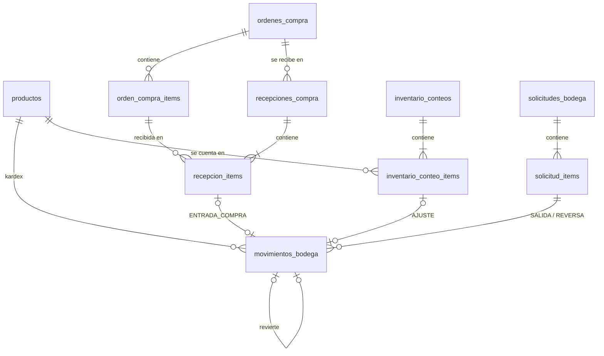
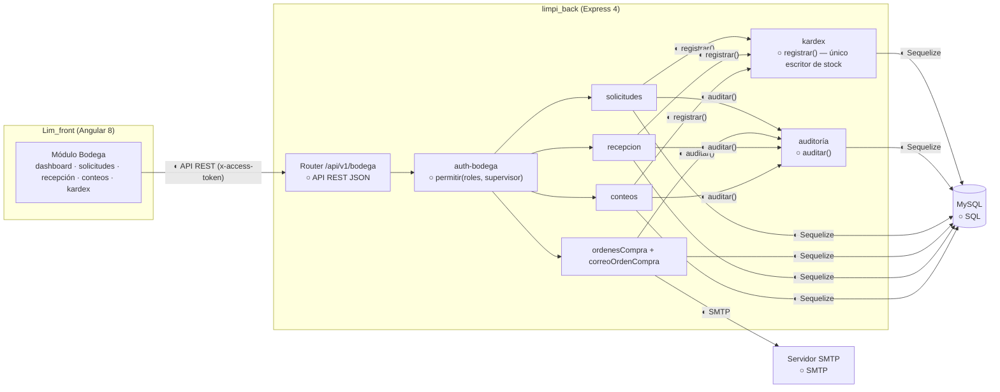
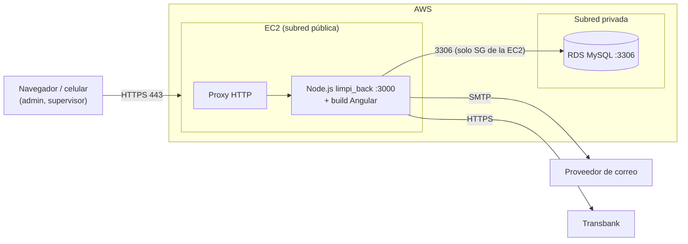

# Correcciones al informe — modelo de bodega (DOC-01)

> Insumo para el informe de la Sumativa 2 (retroalimentación del profesor). Todo lo de aquí está verificado contra el
> código de las ramas RF-BOD-06 (#70), RF-BOD-04b (#71), RF-BOD-07 (#72) y QA-01 (#73). Los diagramas se escriben en
> Mermaid (GitHub los dibuja) para que el informe los copie con los mismos ids.

## 1. Método de valorización (P-1, P-2 → D-175, D-176)

- **Método:** costo promedio ponderado (CPP) **móvil**: el costo se recalcula con cada entrada.
- **Qué se guarda:** cada fila de `movimientos_bodega` guarda el saldo en unidades (`stock_anterior/resultante`) y en
  pesos (`valor_saldo_anterior/resultante`, CLP entero `DECIMAL(14,0)`). El CPP **no se guarda**: se deriva como
  `valor_saldo / stock`, así no hay decimales de moneda.
- **Entrada** (compra, entrada manual, ajuste positivo): `valor = cantidad × costo de la entrada` (en un ajuste
  positivo el costo es el CPP vigente).
- **Salida** (entrega, ajuste negativo): `valor = ROUND(cantidad × valor_saldo / stock)`. Si la salida deja el stock en
  0, se lleva **todo** el valor remanente (no quedan pesos huérfanos por redondeo).
- **Reversa:** copia el costo del movimiento original con signo opuesto (no se revaloriza al CPP del día).
- `productos.costo_unitario` queda como "último costo de compra" (referencia para nuevas OC), no como costo de salida.
- Único escritor de stock: `services/bodega/kardex.js#registrar`, dentro de la transacción del llamador y con el
  producto bloqueado (`FOR UPDATE`). El último saldo se lee con `LOCK IN SHARE MODE` (corrección de QA-01 T1b).

### Ejemplo numérico (es el caso de prueba T2)

| # | Movimiento | Cantidad | Costo unitario | Valor movimiento | Stock | Valor saldo | CPP = valor/stock |
|---|---|---|---|---|---|---|---|
| 1 | SALDO_INICIAL | +10 | $1.000 | $10.000 | 10 | $10.000 | $1.000 |
| 2 | ENTRADA_COMPRA (recepción 1) | +4 | $1.200 | $4.800 | 14 | $14.800 | $1.057 |
| 3 | ENTRADA_COMPRA (recepción 2) | +6 | $1.500 | $9.000 | 20 | $23.800 | **$1.190** |
| 4 | SALIDA_SOLICITUD | −3 | $1.190 | −$3.570 | 17 | $20.230 | $1.190 |
| 5 | REVERSA de #4 | +3 | $1.190 | +$3.570 | 20 | $23.800 | $1.190 |

Filas 1–3 verificadas por el test de integración `qa01.bodega.mysql.test.js` (T2); 4–5 son la regla de T3.
Fila 4: `ROUND(3 × 23.800 / 20) = 3.570`.

## 2. Diccionario de datos (tablas y columnas nuevas)

### 2.1 `movimientos_bodega` (columnas agregadas por RF-BOD-06; todas nullable salvo `estado`)

| Columna | Tipo | Descripción |
|---|---|---|
| `tipo` (existente) | VARCHAR | `ENTRADA_COMPRA`, `SALIDA_SOLICITUD`, `AJUSTE`, `REVERSA`, **`SALDO_INICIAL`**, **`ENTRADA_MANUAL`** |
| `stock_anterior` / `stock_resultante` | INT | Saldo en unidades antes/después del movimiento |
| `costo_unitario` | DECIMAL(14,0) | Costo aplicado (entrada: el de la compra; salida: CPP del momento) |
| `valor_movimiento` | DECIMAL(14,0) | Pesos del movimiento (negativo en salidas) |
| `valor_saldo_anterior` / `valor_saldo_resultante` | DECIMAL(14,0) | Saldo valorizado antes/después |
| `referencia_linea_id` | INT | Línea del documento origen (ítem de solicitud, de recepción o de conteo) |
| `motivo` | VARCHAR(255) | Texto del AJUSTE: el del conteo, "Conteo físico N° X" por defecto, o "Descuadre detectado…" si lo genera el sistema |
| `movimiento_revertido_id` | INT FK → `movimientos_bodega.id` | Solo en REVERSA: el movimiento que anula |
| `estado` | VARCHAR(20) NOT NULL, default `CONFIRMADO` | Los movimientos no se editan ni borran (hooks Sequelize, D-178) |

Índice `(producto_id, id)` para leer el último saldo. Migración `20261121120100` crea un SALDO_INICIAL por producto
con stock (reversible: su `down` borra solo los SALDO_INICIAL que ella creó, filtrando por `referencia_tipo`).

### 2.2 `recepciones_compra` (RF-BOD-04b) — cabecera de cada recepción de una OC

| Columna | Tipo | Descripción |
|---|---|---|
| `id` | INT PK | |
| `orden_id` | INT NOT NULL FK → `ordenes_compra.id` (RESTRICT) | OC recibida |
| `fecha_recepcion` | DATETIME NOT NULL | |
| `documento_tipo` / `documento_numero` | VARCHAR(10) / VARCHAR(50) | Factura / guía del proveedor |
| `observacion` | VARCHAR(255) | |
| `estado` | VARCHAR(20) NOT NULL, default `CONFIRMADA` | |
| `historica` | BOOLEAN NOT NULL, default 0 | 1 = reconstruida por el backfill (aproximación declarada, D-177/D-179) |
| `created_by` / `contexto_usuario` | INT / VARCHAR(20) | Quién recibió y en qué contexto de login |
| `created_at` | DATETIME | |

### 2.3 `recepcion_items` (RF-BOD-04b)

| Columna | Tipo | Descripción |
|---|---|---|
| `id` | INT PK | |
| `recepcion_id` | INT NOT NULL FK → `recepciones_compra.id` | |
| `orden_item_id` | INT NOT NULL FK → `orden_compra_items.id` | Línea de la OC |
| `producto_id` | INT NOT NULL FK → `productos.id` | |
| `cantidad` | INT NOT NULL | Unidades recibidas en esta recepción |
| `costo_unitario` | DECIMAL(14,0) | Costo real facturado (puede diferir del pactado en la OC) |
| `movimiento_id` | INT FK → `movimientos_bodega.id` | ENTRADA_COMPRA generada (NULL en históricas) |

Invariante: `orden_compra_items.cantidad_recibida = Σ recepcion_items.cantidad` (la verifica `scripts/kardex-conciliar.js`).

### 2.4 `inventario_conteos` (RF-BOD-07)

| Columna | Tipo | Descripción |
|---|---|---|
| `id` | INT PK | |
| `fecha` | DATETIME NOT NULL | |
| `responsable_id` / `contexto_usuario` | INT / VARCHAR(20) | Quién creó el conteo |
| `estado` | VARCHAR(20) NOT NULL, default `BORRADOR` | `BORRADOR` → `APROBADO` o `ANULADO` |
| `aprobado_por` / `aprobado_at` | INT / DATETIME | |
| `observacion` | VARCHAR(255) | |
| `created_at` / `updated_at` | DATETIME | |

### 2.5 `inventario_conteo_items` (RF-BOD-07)

| Columna | Tipo | Descripción |
|---|---|---|
| `id` | INT PK | |
| `conteo_id` | INT NOT NULL FK → `inventario_conteos.id` | Único con `producto_id` |
| `producto_id` | INT NOT NULL FK → `productos.id` | |
| `cantidad_teorica` | INT NOT NULL | Stock del sistema al crear el conteo (se recalcula al aprobar) |
| `cantidad_contada` | INT | Capturado en terreno |
| `diferencia` | INT | `contada − teórica` |
| `motivo` | VARCHAR(255) | Opcional (merma, derrame…); pasa al AJUSTE del kardex |
| `movimiento_id` | INT FK → `movimientos_bodega.id` | AJUSTE generado al aprobar |

### 2.6 DER del módulo (tablas nuevas en negrita en el informe)

## 3. Correcciones a los BPMN

| Proceso | Corrección | Evidencia en el código |
|---|---|---|
| Envío de OC (RF-BOD-03) | Si el SMTP falla, la OC **no** pasa a `ENVIADA`: queda en su estado (BORRADOR), se audita `ENVIAR_FALLIDO` y el usuario recibe error 502 `ENVIO_FALLIDO`. El estado cambia solo después de que el correo salió, en una transacción que relee la OC con lock. Agregar evento de error en la tarea "Enviar correo" → fin "OC sin enviar". | `services/bodega/ordenesCompra.js:186-195`; test `tests/services/bodega/ordenesCompra.test.js:98` |
| Anulación de solicitud | La reversa **conserva la referencia** al movimiento original (`movimiento_revertido_id`) y su mismo costo; nunca se borra ni edita la salida. | `kardex.js` (validación `REVERSA_INVALIDA`); QA-01 T3 |
| Recepción de OC (RF-BOD-04b) | Recepción parcial = N recepciones por OC, cada una con documento y costo real. La OC queda `RECIBIDA` cuando Σ recibido = pedido. | `services/bodega/recepcion.js`; QA-01 T2 |
| Conteo físico (RF-BOD-07) | Nuevo proceso: crear (foto teórica) → capturar → aprobar (genera AJUSTE con motivo) o anular. | `services/bodega/conteos.js`; QA-01 T5 |

## 4. UML: ids estables, «include» y «extend»

Los mismos ids se usan en diagramas, casos de uso, pruebas y la matriz (§6).

| Id | Caso de uso | Actor |
|---|---|---|
| CU-BOD-01 | Solicitar insumos / EPP | Supervisor |
| CU-BOD-02 | Cruzar solicitud con stock | Sistema (incluido por CU-BOD-01) |
| CU-BOD-03 | Gestionar y enviar orden de compra | Administrador bodega |
| CU-BOD-04 | Recepcionar orden de compra | Administrador bodega |
| CU-BOD-05 | Entregar solicitud | Administrador bodega |
| CU-BOD-06 | Anular solicitud | Administrador bodega |
| CU-BOD-07 | Consultar kardex valorizado | Administrador bodega |
| CU-BOD-08 | Realizar conteo físico | Administrador bodega |
| CU-BOD-09 | Registrar movimiento en kardex | Sistema |

- **«include»** solo cuando el comportamiento es **obligatorio y reutilizado**: CU-BOD-04, 05, 06 y 08 «include»
  CU-BOD-09 (todos mueven stock solo a través del kardex); CU-BOD-01 «include» CU-BOD-02 (el cruce corre siempre al crear).
- **«extend»** con su condición escrita en el punto de extensión:
  - "Generar lista de compra" «extend» CU-BOD-02 — *condición: cantidad faltante > 0*.
  - "Registrar diferencia de precio" «extend» CU-BOD-04 — *condición: costo real ≠ costo de la línea de la OC*.
  - "Registrar ajuste" «extend» CU-BOD-08 — *condición: diferencia ≠ 0 al aprobar*.
  - "Revertir entregas" «extend» CU-BOD-06 — *condición: la solicitud tenía stock asignado*.

## 5. Componentes y despliegue (separados)

### 5.1 Diagrama de componentes (interfaces provistas ○ / requeridas ◐)

### 5.2 Diagrama de despliegue

Los nodos marcados "proxy", la ubicación del build Angular y la subred se confirman con TI en
`Docs/checklist-validacion-infra-ti.md` (INF-01) antes de pasarlos al informe.

## 6. Matriz de trazabilidad

BPMN → requerimiento → caso de uso → componente → entidad → caso de prueba → evidencia → versión (PR).

| BPMN | Req. | CU | Componente (back / front) | Entidades | Prueba | Evidencia | Versión |
|---|---|---|---|---|---|---|---|
| Solicitud de insumos | RF-BOD-01/02 | CU-BOD-01, 02 | `solicitudes.js` / `solicitud-nueva` | solicitudes_bodega, solicitud_items, movimientos_bodega | QA-01 T1, T1b, T9 | `evidencias-pruebas/2026-11-21-T1.md`, `-T9.md` | #70, #73 |
| Envío de OC | RF-BOD-03 | CU-BOD-03 | `ordenesCompra.js`, `correoOrdenCompra.js` / `ordenes-compra-lista` | ordenes_compra, orden_compra_items | `ordenesCompra.test.js:98` (falla SMTP) | este documento §3 | (previo) |
| Recepción de OC | RF-BOD-04b | CU-BOD-04, 09 | `recepcion.js`, `kardex.js` / `orden-recepcion` | recepciones_compra, recepcion_items, movimientos_bodega | QA-01 T2 | `-T2.md` | #71, #73 |
| Entrega y anulación | RF-BOD-02/06 | CU-BOD-05, 06, 09 | `solicitudes.js`, `kardex.js` / `solicitud-detalle`, `formato-entrega` | movimientos_bodega | QA-01 T3 | `-T3.md` | #70, #73 |
| Kardex valorizado | RF-BOD-06 | CU-BOD-07, 09 | `kardex.js`, `conciliacion.js` / `kardex-producto`, `movimientos-bodega` | movimientos_bodega, productos | QA-01 T4, T6 | `-T4.md`, `-T6.md` | #70, #73 |
| Conteo físico | RF-BOD-07 | CU-BOD-08, 09 | `conteos.js` / `conteos-lista`, `conteo-detalle` | inventario_conteos, inventario_conteo_items | QA-01 T5 | `-T5.md` | #72, #73 |
| Permisos de supervisor | RF-BOD-01 (§2.3) | CU-BOD-01 | `middleware/auth-bodega.js` | — | QA-01 T8 | `-T8.md` | #73 |
| Respaldo y restauración | RNF (§2.5) | — | infraestructura | todas | QA-01 T7 | `-T7.md` (pendiente TI) | INF-01 #74 |
